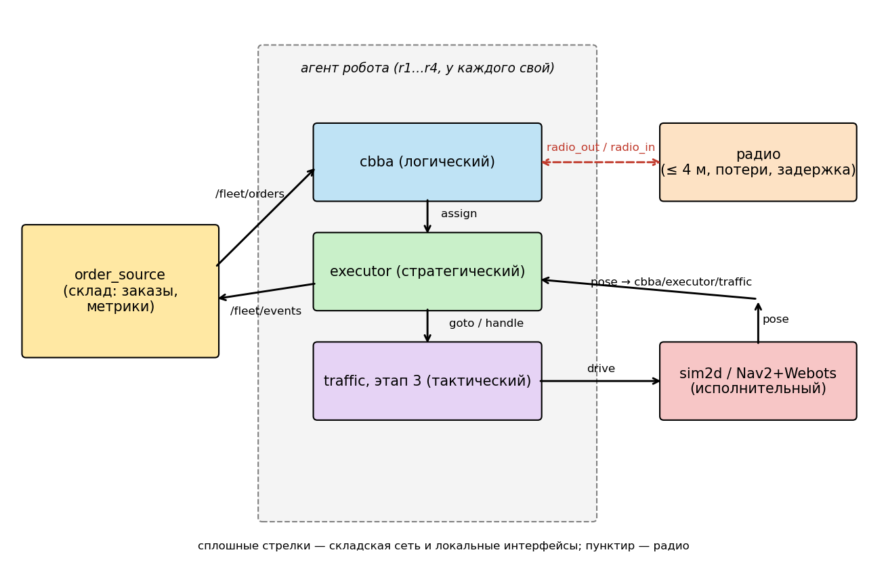
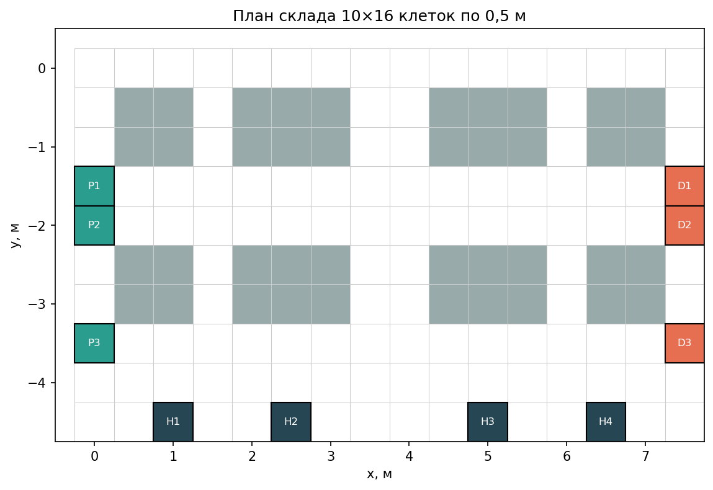

<!-- report: вид=ДЗ; название=«Многороботный склад: распределённое управление группой» -->
<div align="center">

Министерство науки и высшего образования Российской Федерации<br>
Федеральное государственное автономное образовательное учреждение высшего образования<br>
«Московский государственный технический университет имени Н. Э. Баумана<br>
(национальный исследовательский университет)»<br>
Факультет «Специальное машиностроение»<br>
Кафедра СМ7 «Робототехнические системы и мехатроника»

**ОТЧЁТ**<br>
по домашнему заданию<br>
**«Многороботный склад: распределённое управление группой»**<br>
по дисциплине «Управление распределёнными робототехническими системами»

Бригада № 4, вариант № 4

</div>

| | |
|---|---|
| Выполнили студенты группы СМ7-…М | ________ И. О. Фамилия |
| Проверил | ________ М. А. Шереужев |
| Дата сдачи | «…» ________ 20… г. |

<div align="center">Москва, 2026</div>

---

## 1. Задача и требования

Группа из четырёх мобильных роботов обслуживает склад 10 × 16 клеток по 0,5 м. Заказы «забрать груз на станции приёмки P1…P3 и доставить на станцию отгрузки D1…D3» появляются пуассоновским потоком со средней интенсивностью 0,08 заказа в секунду (4,8 заказа в минуту) и заранее не известны.

Распределённость системы означает три вещи. Во-первых, решение о том, кто выполняет заказ, принимают сами роботы, обмениваясь состояниями по радио с дальностью 4 м. Во-вторых, ни один узел не имеет полной картины: складская система публикует список открытых заказов, но не назначает исполнителей. В-третьих, отказ одного робота не должен останавливать остальных.

Проверяемые требования — Р1…Р6 из задания. На текущем этапе работы подтверждена работоспособность инфраструктуры (Р-часть этапа 1); Р1, Р2, Р5 и Р6 будут проверены после реализации шагов этапа 2, а Р3 и Р4 — на этапе 3.

## 2. Исходные данные

| Параметр | Значение |
|---|---|
| Вариант, зерно | 4, `seed = 4` (для базового прогона) |
| Роботов, вместимость пакета, дальность радио, поток заказов | 4 (r1…r4), 3 заказа, 4 м, 0,08 1/с |
| Исследовательский вопрос варианта | при каком потоке заказов (0,05…0,15 1/с) группа перестаёт справляться и что при этом происходит |
| Репозиторий и теги (`hw1`…`hw4`) | … (заполнить) |
| Версии: Ubuntu, ROS 2, Webots, Nav2 | Ubuntu 24.04 (Docker, aarch64), ROS 2 Jazzy, Webots R2025a (на macOS-хосте), Nav2 из пакетов Jazzy |
| Выполненные задания со звёздочкой | пока нет |

Прочие параметры симуляции взяты по умолчанию: скорость робота 0,3 м/с, время погрузки 3 с, дисконт CBBA λ = 0,98, потери радио 0 %, задержка 0,05 с, 6 заказов в начальной партии. Конфигурация варианта — `urrts_bringup/config/warehouse_v4.yaml`; от конфигурации по умолчанию отличается только поток заказов (0,05 → 0,08). Сцена Webots для варианта — `warehouse_webots_v4.yaml` (роботы r1–r4, стоянки H1–H4).

## 3. Этап 1. Архитектура и модель

### 3.1. Четыре уровня управления

Система собрана из четырёх уровней; каждый уровень живёт в своём узле ROS 2, так что на этапе 4 заменяется только исполнительный.

| Уровень | Узел | Вход | Выход |
|---|---|---|---|
| логический | `cbba` | `/fleet/orders`, состояния соседей по радио | `assign` — закреплённый заказ |
| стратегический | `executor` | `assign`, результаты действий | действия `goto`, `handle`; события `/fleet/events` |
| тактический | (этап 3) `traffic` | заявки соседей по радио | действие `drive` |
| исполнительный | симулятор `sim2d` (этап 4 — Nav2 в Webots) | `drive` | движение робота, `pose` |

По радио идёт только то, что роботы решают между собой (состояния CBBA, заявки на клетки), с ограниченной дальностью, потерями и задержкой. По складской сети идут публикация заказов и отчёты о выполнении. Источник заказов играет роль системы управления складом: он не выбирает исполнителя и не разрешает конфликты, поэтому распределённость не нарушается.



Рисунок 1 — Архитектура системы: узлы, топики и действия; пунктиром показан радиообмен между роботами

### 3.2. Склад

Карта задана в `warehouse.yaml`: стеллажи в два ряда блоками, сквозные проходы, станции приёмки P1…P3 на левом краю, отгрузки D1…D3 на правом, стоянки H1…H4 в нижней строке.



Рисунок 2 — План склада (серое — стеллажи, зелёное — приёмка, оранжевое — отгрузка, тёмное — стоянки)

Клетка (строка r, столбец c) соответствует точке (c · 0,5; −r · 0,5) м: начало координат в центре левой верхней клетки, ось x вправо, ось y вверх (`Warehouse.cell_xy`). Обратное преобразование `xy_cell` округляет до ближайшей клетки. Расстояния считаются по кратчайшему пути на сетке (A*, 4-связность), а не по прямой: прямая идёт сквозь стеллажи и занижает время проезда.

Координаты станций (строка, столбец): P1 (3, 0), P2 (4, 0), P3 (7, 0); D1 (3, 15), D2 (4, 15), D3 (7, 15); H1 (9, 2), H2 (9, 5), H3 (9, 10), H4 (9, 13).

### 3.3. Метрики и план испытаний

| Метрика | Как считается | Зачем |
|---|---|---|
| пропускная способность, заказ/мин | доставлено / длительность | основной показатель склада |
| время выполнения заказа, с | от появления до доставки | качество обслуживания |
| ожидание закрепления, с | от появления до взятия в работу | загруженность флота |
| двойные закрепления | число заказов, взятых в работу двумя роботами | нарушение Р1 |
| конфликты путей | число событий «два робота в одной клетке» | нарушение Р3 |

Метрики считает узел `order_source`; итог пишется в `result.json`, заказы — в `orders.csv`, траектории — в `positions.csv`.

**План испытаний.** Конфигурации: этап 2 (без координации движения), этап 3 (резервирование клеток), этап 3 с отказом робота на 300-й секунде. Для каждой — три зерна (1, 2, 3), прогон 600 с модельного времени (ускорение 8×). Для исследовательского вопроса варианта дополнительно поток заказов 0,05; 0,08; 0,10; 0,12; 0,15 1/с при тех же зёрнах, сравниваются пропускная способность и ожидание закрепления.

## 4. Этап 2. Распределение заказов и поведение робота

### 4.0. Базовый прогон (заглушки)

Перед реализацией шагов выполнен прогон на полученном каркасе, чтобы убедиться, что инфраструктура работает:

```
ros2 launch urrts_bringup fleet_sim.launch.py \
  config:=<ws>/src/urrts_bringup/config/warehouse_v4.yaml \
  seed:=4 duration:=120 time_scale:=8 log_dir:=<logs>/e2_v4
```

Сборка проходит; тесты шагов бригады падают с `NotImplementedError` (22 теста), как и описано в задании. Результат прогона (`result.json`):

| Показатель | Значение |
|---|---|
| Модельное время, с | 120 |
| Создано заказов | 13 |
| Открыто | 13 |
| Доставлено | 0 |
| Двойных закреплений | 0 |
| Конфликтов путей | 0 |

Заказы появляются, роботы не едут: `executor` завершается с `NotImplementedError("ДЗ-э2-шаг3: Executor.step")`. Это ожидаемое исходное состояние.

Дополнительно проверена среда этапа 4: Webots R2025a на macOS подключается к ROS 2 в контейнере через внешние контроллеры (TCP, порт 1234), Nav2 поднимается для всех роботов. В `fleet_webots.launch.py` добавлен режим удалённого Webots (переменная `URRTS_WEBOTS_REMOTE=1`).

### 4.1. CBBA на потоке заказов

*Раздел заполняется после реализации шагов 1–2 (`build_bundle`, `consensus`): что хранит агент, как заказ появляется, закрепляется и уходит из аукциона, правило освобождения.*

### 4.2. Автомат исполнителя

*Раздел заполняется после шага 3 (`Executor.step`): диаграмма состояний (рисунок 3, рисуется до кода), таблица переходов, обоснование разной обработки отказа навигации до и после погрузки.*

### 4.3. Результаты этапа 2

*Таблица 1 (3 зерна, 600 с) заполняется после реализации. Столбцы: зерно, создано, доставлено, заказ/мин, время выполнения (среднее / наибольшее), ожидание закрепления, двойные закрепления, конфликты путей.*

## 5. Статус работы

| Пункт | Состояние |
|---|---|
| Сборка и тесты | выполнено |
| Конфигурация варианта 4 | выполнено |
| План склада и координаты | выполнено (рис. 2) |
| Метрики | описаны (п. 3.3) |
| План испытаний | составлен (п. 3.3) |
| Базовый прогон | выполнен (п. 4.0) |
| Шаги этапа 2 (CBBA, автомат) | не начаты |
| Схема архитектуры (рис. 1) | выполнено |

## Приложение А. Воспроизведение

```bash
docker exec -it ros2-jazzy bash
cd /root/urrts_ws && colcon build --symlink-install && source install/setup.bash
ros2 launch urrts_bringup fleet_sim.launch.py \
  config:=$PWD/src/urrts_bringup/config/warehouse_v4.yaml \
  seed:=4 duration:=120 time_scale:=8 log_dir:=/root/urrts_logs/e2_v4
```

Рабочая копия — в ASCII-пути `/root/urrts_ws` (colcon не собирает пакеты по пути с кириллицей).
